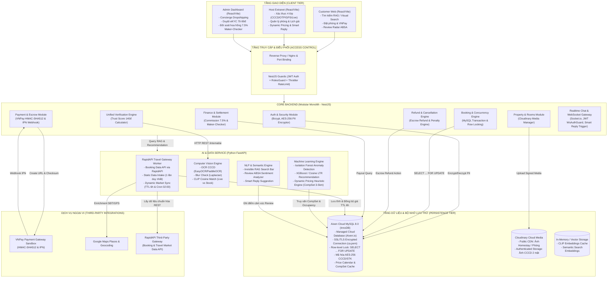

# TÀI LIỆU THIẾT KẾ KIẾN TRÚC TỔNG THỂ HỆ THỐNG
**Dự án**: Sàn Giao dịch Homestay Lai tích hợp AI (Homestay Booking & AI Hybrid Marketplace)  
**Phiên bản**: 2.1 | **Ngày lập**: 16/10/2026 | **Tài liệu tham chiếu**: `Homestay_All_in_One_Business_Requirements_v2.1.xlsx`

---

## 1. MÔ HÌNH KIẾN TRÚC TỔNG THỂ (HIGH-LEVEL ARCHITECTURE)

Hệ thống được thiết kế theo kiến trúc lai **Modular Monolith kết hợp AI Microservice** nhằm đạt được sự cân bằng tối ưu giữa tốc độ phát triển đồ án và tính độc lập của các tác vụ tính toán AI nặng:

---

## 2. NGUYÊN TẮC THIẾT KẾ CỐT LÕI (DESIGN PRINCIPLES)

1. **Zero-Trust Client (Không tin tưởng phía Client)**:
   - Toàn bộ số tiền đơn hàng, lịch giá, phí hoa hồng, trạng thái xác thực và phân quyền đều do Backend NestJS tự tính toán từ Database MySQL. Client không có quyền gửi tổng tiền `total_amount` lên server.
2. **Nguyên tắc Đồng nhất (Unified Pipeline)**:
   - Không tạo luồng riêng rẽ cho Host Đăng mới và Host Claim nhà cào. Cả hai cùng đi qua một **Pipeline Xác thực 4 bước (Trust Score 140 điểm)**: CCCD (+40đ) + OTP (+30đ) + GPS Haversine (+30đ) + AI Live Vision (+40đ).
3. **Mô hình Dòng tiền Ký quỹ (Escrow Model)**:
   - Tiền thanh toán của khách qua VNPay luôn nằm tại tài khoản Sàn (Escrow). Sàn chỉ giải ngân cho Host sau 24h kể từ khi khách Check-in thành công. Sàn trực tiếp hoàn tiền cho khách khi có yêu cầu hủy hợp lệ theo chính sách của phòng.
4. **Bảo mật Dữ liệu Nhạy cảm (PII & PCI-DSS Compliance)**:
   - Số CCCD, đường dẫn ảnh CCCD và Số tài khoản ngân hàng của Host bắt buộc mã hóa đối xứng **AES-256-CBC** trước khi ghi vào MySQL.
   - Ảnh CCCD lưu trữ tại Cloudinary ở chế độ **Private (Authenticated)**, chỉ xem được qua URL tạm thời có gắn chữ ký số của Admin.
5. **Cơ chế Khóa dòng Chống Overbooking (Pessimistic Concurrency)**:
   - Sử dụng cú pháp chuẩn của MySQL 8.0 InnoDB `SELECT ... FOR UPDATE` trong Transaction khi khách tạo đơn đặt phòng, đảm bảo loại bỏ hoàn toàn tình trạng 2 khách đặt trùng 1 phòng vào cùng thời điểm.
6. **Chiến lược Thu thập Dữ liệu & Tối ưu Request (RapidAPI & 2-Tier Data Strategy)**:
   - Thay vì cào HTML trực tiếp từ Booking.com dễ bị Cloudflare / Bot detection chặn, hệ thống tích hợp API bên thứ ba là **RapidAPI (Travel & Booking Data Engine)** trả về định dạng RESTful JSON chuẩn hóa, an toàn và ổn định.
   - Áp dụng triệt để mô hình 2 tầng dữ liệu:
     + **Tầng Dữ liệu Tĩnh** (Tên homestay, địa chỉ, tọa độ GPS, album ảnh gốc, danh mục tiện nghi): Chỉ thu thập 1 lần duy nhất và lưu cố định vào MySQL (vĩnh viễn không gọi lại API ngoài để tối ưu quota request).
     + **Tầng Dữ liệu Động** (Giá phòng hôm nay/cuối tuần, Tỷ lệ phòng kín Occupancy Rate của các homestay đối thủ xung quanh): Bắt buộc cập nhật để nuôi thuật toán AI Dynamic Pricing. Áp dụng cơ chế **Cache hết hạn TTL 6 tiếng (On-Demand)** khi Host mở bảng lịch giá kết hợp **Cronjob ngầm lúc 02:00 sáng** mỗi ngày quét dữ liệu 7-14 ngày tới.

