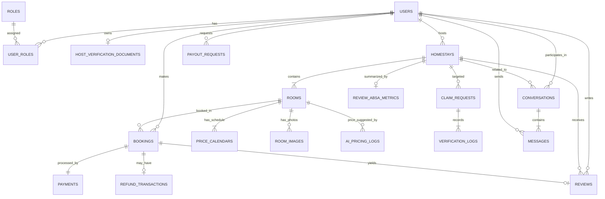

# THIẾT KẾ CƠ SỞ DỮ LIỆU CHI TIẾT (DATABASE DESIGN & ERD)
**Hệ quản trị CSDL**: Aiven for MySQL 8.0 Cloud Database (Storage Engine: InnoDB, Charset: utf8mb4, Collation: utf8mb4_unicode_ci, Bắt buộc kết nối SSL/TLS qua CA Certificate)  
**Tài liệu tham chiếu**: `Homestay_All_in_One_Business_Requirements_v2.1.xlsx`

---

## 1. SƠ ĐỒ QUAN HỆ THỰC THỂ (ENTITY RELATIONSHIP DIAGRAM - ERD)

---

## 2. TỪ ĐIỂN DỮ LIỆU CHI TIẾT CÁC BẢNG (DATA DICTIONARY)

### 2.1. Nhóm Người dùng & Phân quyền (Auth & RBAC)

#### Bảng `users`
Lưu trữ thông tin tài khoản người dùng trên sàn.

| Cột (Column) | Kiểu dữ liệu | Khóa | Nullable | Mô tả & Ràng buộc |
| :--- | :--- | :---: | :---: | :--- |
| `id` | BIGINT UNSIGNED | PK | NO | Khóa chính tự tăng |
| `email` | VARCHAR(191) | UNIQUE | NO | Email đăng nhập |
| `phone_number` | VARCHAR(20) | UNIQUE | YES | Số điện thoại đăng ký chính chủ |
| `password_hash` | VARCHAR(255) | | NO | Mật khẩu băm Bcrypt (salt rounds = 10) |
| `full_name` | VARCHAR(100) | | NO | Họ và tên hiển thị |
| `avatar_url` | VARCHAR(500) | | YES | Đường dẫn ảnh đại diện trên Cloudinary |
| `is_active` | TINYINT(1) | | NO | 1: Hoạt động, 0: Đang bị khóa |
| `created_at` | TIMESTAMP | | NO | Thời gian tạo tài khoản |
| `updated_at` | TIMESTAMP | | NO | Thời gian cập nhật gần nhất |

#### Bảng `roles` & `user_roles`
Hỗ trợ phân quyền linh hoạt theo vai trò (RBAC).

| Bảng | Cột | Kiểu | Khóa | Mô tả |
| :--- | :--- | :--- | :---: | :--- |
| `roles` | `id` | INT | PK | Mã vai trò (1: CUSTOMER, 2: HOST, 3: ADMIN, 4: CONCIERGE) |
| `roles` | `code` | VARCHAR(50) | UNIQUE | Tên mã định danh vai trò |
| `user_roles` | `user_id` | BIGINT UNSIGNED | FK | Liên kết `users.id` |
| `user_roles` | `role_id` | INT | FK | Liên kết `roles.id` |

---

### 2.2. Nhóm Định danh Host & eKYC CCCD (`REQ-004`, `REQ-015`, `BR-012`, `BR-020`)

#### Bảng `host_verification_documents`
Lưu trữ thông tin căn cước công dân và tài khoản ngân hàng của Host được mã hóa an toàn.

| Cột (Column) | Kiểu dữ liệu | Khóa | Nullable | Mô tả & Ràng buộc |
| :--- | :--- | :---: | :---: | :--- |
| `id` | BIGINT UNSIGNED | PK | NO | Khóa chính tự tăng |
| `user_id` | BIGINT UNSIGNED | FK, UNIQUE | NO | Liên kết `users.id` (1 Host chỉ có 1 hồ sơ CCCD) |
| `cccd_number_aes` | TEXT | | NO | **Số CCCD mã hóa đối xứng AES-256-CBC** |
| `cccd_hash` | VARCHAR(64) | INDEX | NO | Mã băm SHA-256 của số CCCD để tra cứu chống trùng |
| `full_name_on_cccd` | VARCHAR(100) | | NO | Họ tên đọc từ CCCD (chuẩn hóa chữ hoa không dấu) |
| `date_of_birth` | DATE | | YES | Ngày sinh trên CCCD |
| `front_image_url_aes` | TEXT | | NO | **URL ảnh mặt trước CCCD Private trên Cloudinary (AES-256)** |
| `back_image_url_aes` | TEXT | | NO | **URL ảnh mặt sau CCCD Private trên Cloudinary (AES-256)** |
| `bank_account_number_aes` | TEXT | | YES | **Số tài khoản ngân hàng của Host (AES-256)** |
| `bank_account_name` | VARCHAR(100) | | YES | **Tên chủ thẻ ngân hàng (bắt buộc khớp 100% tên CCCD)** |
| `bank_name` | VARCHAR(100) | | YES | Tên ngân hàng thụ hưởng (Vietcombank, MB, Techcombank...) |
| `verification_status` | ENUM | | NO | `PENDING`, `VERIFIED`, `REJECTED` (Mặc định: `PENDING`) |
| `rejection_reason` | VARCHAR(255) | | YES | Lý do từ chối nếu không hợp lệ |
| `verified_at` | TIMESTAMP | | YES | Thời điểm phê duyệt |

---

### 2.3. Nhóm Homestay, Phòng & Lịch giá (Inventory & Price Calendar)

#### Bảng `homestays`
Lưu trữ thông tin chỗ nghỉ (cả hàng cào về và hàng chủ nhà đăng mới).

| Cột (Column) | Kiểu dữ liệu | Khóa | Nullable | Mô tả & Ràng buộc |
| :--- | :--- | :---: | :---: | :--- |
| `id` | BIGINT UNSIGNED | PK | NO | Khóa chính tự tăng |
| `host_id` | BIGINT UNSIGNED | FK | YES | `users.id` sở hữu (Nếu là hàng cào về: gán System Bot ID) |
| `name` | VARCHAR(255) | INDEX | NO | Tên Homestay |
| `address` | VARCHAR(500) | | NO | Địa chỉ chi tiết |
| `city` | VARCHAR(100) | INDEX | NO | Thành phố (Đà Lạt, Hà Nội, Vũng Tàu...) |
| `latitude` | DECIMAL(10, 8) | INDEX | NO | Tọa độ Vĩ độ GPS (dùng đo khoảng cách Haversine) |
| `longitude` | DECIMAL(11, 8) | INDEX | NO | Tọa độ Kinh độ GPS |
| `crawled_phone` | VARCHAR(20) | | YES | Số điện thoại làm giàu từ Google Maps |
| `source_url` | VARCHAR(500) | UNIQUE | YES | Link hoặc ID gốc từ RapidAPI Travel Gateway (đảm bảo không trùng) |
| `is_claimed` | TINYINT(1) | INDEX | NO | **0: UNCLAIMED (hàng đồng bộ/nháp), 1: CLAIMED (chính chủ)** |
| `last_price_synced_at` | TIMESTAMP | INDEX | YES | **Thời điểm đồng bộ giá thị trường lần cuối từ RapidAPI (Dùng kiểm tra Cache TTL 6 tiếng cho On-Demand)** |
| `cancellation_policy` | ENUM | | NO | `FLEXIBLE`, `MODERATE`, `STRICT`, `NON_REFUNDABLE` |
| `amenities_json` | JSON | | YES | Danh sách tiện nghi tĩnh (Wifi, Bếp, BBQ, Hồ bơi...) - Cào 1 lần |
| `rules_json` | JSON | | YES | Nội quy chỗ nghỉ |
| `status` | ENUM | | NO | `DRAFT`, `PENDING_VERIFICATION`, `ACTIVE`, `BANNED` |

#### Bảng `rooms` & `price_calendars` (`REQ-003`, `REQ-011`, `BR-007`)
Quản lý loại phòng và bảng giá từng ngày (chống Overbooking bằng `SELECT ... FOR UPDATE` và lưu dữ liệu nuôi AI Dynamic Pricing).

| Bảng | Cột | Kiểu dữ liệu | Khóa | Mô tả |
| :--- | :--- | :--- | :---: | :--- |
| `rooms` | `id` | BIGINT UNSIGNED | PK | Mã phòng |
| `rooms` | `homestay_id` | BIGINT UNSIGNED | FK | Thuộc homestay nào |
| `rooms` | `room_name` | VARCHAR(100) | | Tên phòng (Phòng đôi, Căn hộ gia đình...) |
| `rooms` | `capacity` | INT | | Số lượng khách tối đa |
| `rooms` | `base_price` | DECIMAL(12, 2) | | Giá gốc niêm yết của Host |
| `price_calendars` | `id` | BIGINT UNSIGNED | PK | Mã bản ghi lịch giá |
| `price_calendars` | `room_id` | BIGINT UNSIGNED | FK, UNIQUE(room_id, date) | Mã phòng liên kết |
| `price_calendars` | `date` | DATE | INDEX | Ngày phòng (trong 14 ngày tới) |
| `price_calendars` | `price` | DECIMAL(12, 2) | | Giá bán thực tế của ngày hôm đó |
| `price_calendars` | `is_available`| TINYINT(1) | | 1: Còn phòng, 0: Đã kín |
| `price_calendars` | `comp_set_avg_price` | DECIMAL(12, 2) | | **Giá trung bình thị trường $P_{market}$ của 5-10 đối thủ trong bán kính 3-5km** |
| `price_calendars` | `comp_set_occupancy_rate`| DECIMAL(5, 2) | | **Tỷ lệ kín phòng khu vực $Occ$ (%) đồng bộ từ RapidAPI** |
| `price_calendars` | `ai_suggested_price` | DECIMAL(12, 2) | | **Mức giá AI đề xuất theo thuật toán Dynamic Pricing** |
| `price_calendars` | `is_ai_applied` | TINYINT(1) | | 1: Host đã bấm Áp dụng, 0: Giữ nguyên giá gốc |
| `price_calendars` | `locked_until`| TIMESTAMP | | **Hạn khóa phòng tạm thời (15 phút chờ thanh toán)** |

---

### 2.4. Nhóm Quy trình Xác thực Đồng nhất 4 Lớp (`REQ-010`, `BR-003`)

#### Bảng `claim_requests` & `verification_logs`
Ghi nhận toàn bộ tiến trình và bằng chứng của bài kiểm tra Trust Score 140 điểm.

| Bảng | Cột | Kiểu | Mô tả |
| :--- | :--- | :--- | :--- |
| `claim_requests` | `id` | BIGINT UNSIGNED (PK) | Mã yêu cầu xác thực |
| `claim_requests` | `homestay_id` | BIGINT UNSIGNED (FK) | Homestay cần xác thực (đăng mới hoặc claim) |
| `claim_requests` | `user_id` | BIGINT UNSIGNED (FK) | Người gửi yêu cầu xác thực |
| `claim_requests` | `cccd_score` | INT | Điểm CCCD (+40đ nếu hợp lệ) |
| `claim_requests` | `otp_score` | INT | Điểm OTP (+30đ nếu nhập đúng trong 180s) |
| `claim_requests` | `gps_score` | INT | Điểm GPS (+30đ nếu khoảng cách $\le 150m$) |
| `claim_requests` | `live_vision_score` | INT | Điểm AI Camera (+40đ nếu Cosine $\ge 0.75$) |
| `claim_requests` | `total_trust_score` | INT | Tổng điểm tín nhiệm (Max 140đ) |
| `claim_requests` | `status` | ENUM | `PENDING`, `AUTO_APPROVED` ($\ge 100$), `PENDING_ADMIN` (70-99), `REJECTED` |
| `verification_logs` | `id` | BIGINT UNSIGNED (PK) | Bản ghi lịch sử chi tiết |
| `verification_logs` | `claim_request_id` | BIGINT UNSIGNED (FK) | Liên kết yêu cầu |
| `verification_logs` | `haversine_distance_m` | DECIMAL(8, 2) | Khoảng cách đo được bằng mét |
| `verification_logs` | `cosine_similarity` | DECIMAL(5, 4) | Độ tương đồng ảnh đo bởi CLIP (0.0000 - 1.0000) |
| `verification_logs` | `live_photo_url` | VARCHAR(500) | Ảnh chụp Live tại hiện trường lưu Cloudinary |

---

### 2.5. Nhóm Đặt phòng, Thanh toán VNPay & Hoàn tiền Ký quỹ (`REQ-011` $\rightarrow$ `REQ-016`, `BR-021`)

#### Bảng `bookings`
Lưu trữ thông tin đơn đặt phòng.

| Cột (Column) | Kiểu dữ liệu | Khóa | Nullable | Mô tả & Ràng buộc |
| :--- | :--- | :---: | :---: | :--- |
| `id` | BIGINT UNSIGNED | PK | NO | Khóa chính tự tăng |
| `booking_code` | VARCHAR(32) | UNIQUE | NO | Mã đặt phòng ngẫu nhiên (VD: `BK20261016XXXX`) |
| `customer_id` | BIGINT UNSIGNED | FK | NO | Người đặt phòng (`users.id`) |
| `homestay_id` | BIGINT UNSIGNED | FK | NO | Homestay được đặt |
| `room_id` | BIGINT UNSIGNED | FK | NO | Phòng được đặt |
| `check_in_date` | DATE | INDEX | NO | Ngày nhận phòng |
| `check_out_date` | DATE | INDEX | NO | Ngày trả phòng |
| `total_amount` | DECIMAL(12, 2) | | NO | Tổng tiền phòng (Backend tự tính Zero-Trust) |
| `commission_rate`| DECIMAL(5, 4) | | NO | Tỷ lệ hoa hồng sàn (**cố định 0.075 = 7.5%**) |
| `commission_amount`| DECIMAL(12, 2)| | NO | Tiền hoa hồng sàn giữ lại (`total_amount * 0.075`) |
| `net_host_payout`| DECIMAL(12, 2)| | NO | Tiền thực nhận của Host (`total_amount - commission`) |
| `is_dropship` | TINYINT(1) | | NO | 1: Đơn vào nhà chưa có chủ (`is_claimed = 0`) |
| `status` | ENUM | INDEX | NO | `PENDING_PAYMENT`, `PAID`, `CHECKED_IN`, `COMPLETED`, `CANCELLED`, `DROPSHIP_ORDER` |
| `checked_in_at` | TIMESTAMP | | YES | Thời điểm Host/Khách xác nhận đã nhận phòng |
| `checked_out_at`| TIMESTAMP | | YES | Thời điểm hoàn tất trả phòng (Kích hoạt quyền Review) |

#### Bảng `payments` (VNPay Integration)
Lưu trữ thông tin giao dịch thanh toán để đối chiếu và bảo đảm tính lũy đẳng (Idempotency).

| Cột (Column) | Kiểu dữ liệu | Khóa | Mô tả |
| :--- | :--- | :---: | :--- |
| `id` | BIGINT UNSIGNED | PK | Mã giao dịch thanh toán |
| `booking_id` | BIGINT UNSIGNED | FK, UNIQUE | Liên kết đơn đặt phòng |
| `vnp_txn_ref` | VARCHAR(100) | UNIQUE | Mã tham chiếu gửi sang VNPay |
| `vnp_transaction_no` | VARCHAR(100) | | Mã giao dịch phía cổng VNPay trả về |
| `amount` | DECIMAL(12, 2) | | Số tiền thanh toán thực tế |
| `bank_code` | VARCHAR(20) | | Mã ngân hàng khách quét thanh toán (NCB, VCB...) |
| `secure_hash` | VARCHAR(255) | | Chữ ký HMAC-SHA512 kiểm tra |
| `status` | ENUM | | `INITIAL`, `SUCCESS`, `FAILED` |
| `ipn_response_json` | JSON | | Toàn bộ payload gói tin IPN Webhook lưu trữ phục vụ đối soát |

#### Bảng `refund_transactions` (`BR-021`, `FLOW-11`)
Xử lý hoàn tiền Ký quỹ Escrow về cho Khách khi hủy đơn.

| Cột (Column) | Kiểu dữ liệu | Khóa | Mô tả |
| :--- | :--- | :---: | :--- |
| `id` | BIGINT UNSIGNED | PK | Mã giao dịch hoàn tiền |
| `booking_id` | BIGINT UNSIGNED | FK | Liên kết đơn hủy |
| `cancellation_reason` | VARCHAR(255) | | Lý do hủy phòng |
| `refund_percentage` | INT | | Tỷ lệ hoàn tiền theo chính sách (100%, 50%, 0%) |
| `refund_amount` | DECIMAL(12, 2) | | Số tiền Sàn hoàn trả về STK khách |
| `host_penalty_amount` | DECIMAL(12, 2) | | Tiền phạt Host nếu Host tự ý hủy phòng (phạt 20%) |
| `refund_status` | ENUM | | `PENDING`, `PROCESSED`, `REJECTED` |
| `processed_by` | BIGINT UNSIGNED | FK | Admin duyệt hoàn tiền hoặc tự động qua API |

#### Bảng `payout_requests` (`REQ-016`, `BR-013`, `BR-020`)
Quy trình Maker-Checker giải ngân doanh thu cho Host.

| Cột (Column) | Kiểu dữ liệu | Khóa | Mô tả |
| :--- | :--- | :---: | :--- |
| `id` | BIGINT UNSIGNED | PK | Mã yêu cầu thanh toán |
| `host_id` | BIGINT UNSIGNED | FK | Chủ nhà nhận tiền |
| `period_month` | VARCHAR(7) | | Kỳ đối soát (VD: `2026-10`) |
| `gross_revenue` | DECIMAL(12, 2) | | Tổng doanh thu tiền phòng |
| `commission_fee`| DECIMAL(12, 2) | | Tiền hoa hồng sàn giữ lại (7.5%) |
| `net_payout` | DECIMAL(12, 2) | | Tiền thực nhận sau khi cấn trừ phạt (nếu có) |
| `bank_account_verified`| TINYINT(1)| | Xác nhận Tên chủ thẻ khớp 100% tên CCCD |
| `maker_system_log` | JSON | | Dữ liệu bảng kê tính tự động (Maker) |
| `checker_admin_id` | BIGINT UNSIGNED | FK | Admin ký duyệt chuyển khoản (Checker) |
| `receipt_image_url` | VARCHAR(500) | | Ảnh chứng từ/Ủy nhiệm chi ngân hàng tải lên |
| `status` | ENUM | | `PENDING`, `APPROVED`, `REJECTED` |

---

### 2.6. Nhóm AI Sentiment, RAG & Anomaly Detection

#### Bảng `reviews` & `review_absa_metrics` (`REQ-019`, `BR-016`, `BR-018`)
Hệ thống đánh giá & bình luận sau lưu trú (Chỉ áp dụng cho đơn đã hoàn tất Check-in & Check-out).

| Bảng | Cột | Kiểu dữ liệu | Khóa | Nullable | Mô tả & Ràng buộc |
| :--- | :--- | :--- | :---: | :---: | :--- |
| `reviews` | `id` | BIGINT UNSIGNED | PK | NO | Mã đánh giá tự tăng |
| `reviews` | `booking_id` | BIGINT UNSIGNED | FK, UNIQUE | NO | **Ràng buộc: 1 đơn COMPLETED chỉ được review đúng 1 lần** |
| `reviews` | `customer_id` | BIGINT UNSIGNED | FK | NO | Khách hàng viết đánh giá (`users.id`) |
| `reviews` | `homestay_id` | BIGINT UNSIGNED | FK, INDEX | NO | Homestay nhận đánh giá |
| `reviews` | `rating_overall` | TINYINT | | NO | Điểm tổng thể (1 đến 5 sao) |
| `reviews` | `cleanliness_rating` | TINYINT | | YES | Điểm tiêu chí Vệ sinh sạch sẽ (1 - 5 sao) |
| `reviews` | `service_rating` | TINYINT | | YES | Điểm tiêu chí Dịch vụ & Thái độ Host (1 - 5 sao) |
| `reviews` | `location_rating` | TINYINT | | YES | Điểm tiêu chí Vị trí & Cảnh quan (1 - 5 sao) |
| `reviews` | `comment` | TEXT | | NO | Nội dung nhận xét chi tiết |
| `reviews` | `review_images_json` | JSON | | YES | Mảng các URL ảnh thực tế khách chụp upload Cloudinary |
| `reviews` | `status` | ENUM | INDEX | NO | `APPROVED`, `FLAGGED_FRAUD` (bị AI bắt), `HIDDEN` |
| `reviews` | `created_at` | TIMESTAMP | INDEX | NO | Thời điểm gửi đánh giá |
| `review_absa_metrics`| `id` | BIGINT UNSIGNED | PK | NO | Mã phân tích cảm xúc |
| `review_absa_metrics`| `homestay_id` | BIGINT UNSIGNED | FK | NO | Homestay được tổng hợp |
| `review_absa_metrics`| `cleanliness_score`| DECIMAL(3, 2) | | NO | Điểm khía cạnh Vệ sinh (1.00 - 5.00) |
| `review_absa_metrics`| `noise_score` | DECIMAL(3, 2) | | NO | Điểm khía cạnh Tiếng ồn/Yên tĩnh |
| `review_absa_metrics`| `service_score` | DECIMAL(3, 2) | | NO | Điểm khía cạnh Dịch vụ & Chủ nhà |
| `review_absa_metrics`| `location_score` | DECIMAL(3, 2) | | NO | Điểm khía cạnh Vị trí |
| `review_absa_metrics`| `ai_summary_vn` | VARCHAR(500) | | YES | 2 câu tóm tắt nhanh ưu/nhược điểm do AI tạo |

#### Bảng `fraud_logs` (`REQ-026`, `FLOW-09`)
Lưu trữ cảnh báo dị biệt do mô hình học máy **Isolation Forest** phát hiện.

| Cột (Column) | Kiểu dữ liệu | Mô tả |
| :--- | :--- | :--- |
| `id` | BIGINT UNSIGNED (PK) | Mã cảnh báo |
| `target_type` | ENUM(`USER`, `BOOKING`, `REVIEW`) | Đối tượng bị nghi ngờ |
| `target_id` | BIGINT UNSIGNED | ID của đối tượng |
| `anomaly_score` | DECIMAL(5, 4) | Điểm dị biệt tính bởi Isolation Forest (-1.0000 đến 0.0000) |
| `detection_reason`| VARCHAR(255) | Lý do (Spam review cùng IP, Đặt hủy phòng bất thường...) |
| `is_resolved` | TINYINT(1) | 0: Cần Admin xử lý, 1: Đã xác minh |

#### Bảng `ai_pricing_logs` (`REQ-021`, `BR-015`, `FLOW-06`)
Lưu trữ lịch sử gợi ý giá thông minh theo ngày từ động cơ **AI Dynamic Pricing** kết hợp dữ liệu CompSet từ RapidAPI.

| Cột (Column) | Kiểu dữ liệu | Khóa | Nullable | Mô tả & Ràng buộc |
| :--- | :--- | :---: | :---: | :--- |
| `id` | BIGINT UNSIGNED | PK | NO | Mã bản ghi tự tăng |
| `room_id` | BIGINT UNSIGNED | FK, INDEX | NO | Phòng được AI gợi ý định giá (`rooms.id`) |
| `target_date` | DATE | INDEX | NO | Ngày được AI tính toán định giá |
| `base_price` | DECIMAL(12, 2) | | NO | Giá gốc niêm yết của Host |
| `market_comp_price`| DECIMAL(12, 2) | | YES | Giá trung bình của cụm đối thủ tương đồng CompSet lân cận 3-5km ($P_{\text{market}}$) |
| `comp_occupancy_rate`| DECIMAL(5, 2)| | YES | Tỷ lệ kín phòng khu vực ($Occ$ %) |
| `suggested_price` | DECIMAL(12, 2) | | NO | Giá AI đề xuất sau khi áp trần an toàn $\pm 30\%$ ($P_{\text{suggest}}$) |
| `applied_price` | DECIMAL(12, 2) | | YES | Mức giá thực tế Host chấp thuận áp dụng |
| `ai_explanation_vn`| VARCHAR(500) | | YES | Giải thích minh bạch XAI bằng tiếng Việt cho Host |
| `status` | ENUM | INDEX | NO | `SUGGESTED`, `APPLIED`, `REJECTED`, `EXPIRED` |
| `created_at` | TIMESTAMP | | NO | Thời điểm AI tính toán sinh gợi ý |

---

### 2.7. Nhóm Tin nhắn & Hội thoại Realtime (Chat & Conversations) (`REQ-022`)

#### Bảng `conversations`
Lưu trữ phiên hội thoại giữa 1 Khách hàng và 1 Chủ nhà (Host) theo Homestay.

| Cột (Column) | Kiểu dữ liệu | Khóa | Nullable | Mô tả & Ràng buộc |
| :--- | :--- | :---: | :---: | :--- |
| `id` | BIGINT UNSIGNED | PK | NO | Khóa chính tự tăng |
| `customer_id` | BIGINT UNSIGNED | FK | NO | Người gửi/hỏi đầu tiên (`users.id`) |
| `host_id` | BIGINT UNSIGNED | FK | NO | Chủ nhà nhận tin (`users.id`) |
| `homestay_id` | BIGINT UNSIGNED | FK | NO | Homestay đang được trao đổi |
| `booking_id` | BIGINT UNSIGNED | FK | YES | Đơn đặt phòng liên quan (nếu đã đặt) |
| `last_message_content`| TEXT | | YES | Trích dẫn nội dung tin nhắn mới nhất |
| `last_message_time` | TIMESTAMP | INDEX | NO | Thời điểm gửi tin nhắn gần nhất |
| `unread_count_customer`| INT UNSIGNED | | NO | Số tin nhắn chưa đọc của Khách (Mặc định: 0) |
| `unread_count_host` | INT UNSIGNED | | NO | Số tin nhắn chưa đọc của Host (Mặc định: 0) |
| `created_at` | TIMESTAMP | | NO | Thời điểm tạo cuộc trò chuyện |
| `updated_at` | TIMESTAMP | | NO | Thời điểm cập nhật trạng thái |

*Ràng buộc duy nhất*: `UNIQUE KEY uk_chat_pair (customer_id, host_id, homestay_id)` (Tránh tạo nhiều cuộc trò chuyện trùng lặp giữa cùng 1 cặp khách - chủ cho 1 homestay).

#### Bảng `messages`
Lưu trữ chi tiết từng tin nhắn văn bản, hình ảnh và tin nhắn trả lời nhanh (Smart Reply).

| Cột (Column) | Kiểu dữ liệu | Khóa | Nullable | Mô tả & Ràng buộc |
| :--- | :--- | :---: | :---: | :--- |
| `id` | BIGINT UNSIGNED | PK | NO | Khóa chính tự tăng |
| `conversation_id` | BIGINT UNSIGNED | FK, INDEX | NO | Thuộc cuộc hội thoại nào |
| `sender_id` | BIGINT UNSIGNED | FK | NO | Người gửi tin (`users.id`) |
| `receiver_id` | BIGINT UNSIGNED | FK | NO | Người nhận tin (`users.id`) |
| `message_type` | ENUM | | NO | `TEXT`, `IMAGE`, `SMART_REPLY` (Mặc định: `TEXT`) |
| `content` | TEXT | | NO | Nội dung tin nhắn |
| `media_url` | VARCHAR(500) | | YES | Đường dẫn ảnh đính kèm trên Cloudinary |
| `is_read` | TINYINT(1) | INDEX | NO | 0: Chưa đọc, 1: Đã đọc |
| `read_at` | TIMESTAMP | | YES | Thời điểm đối phương xem tin nhắn |
| `created_at` | TIMESTAMP | INDEX | NO | Thời gian gửi tin nhắn |

