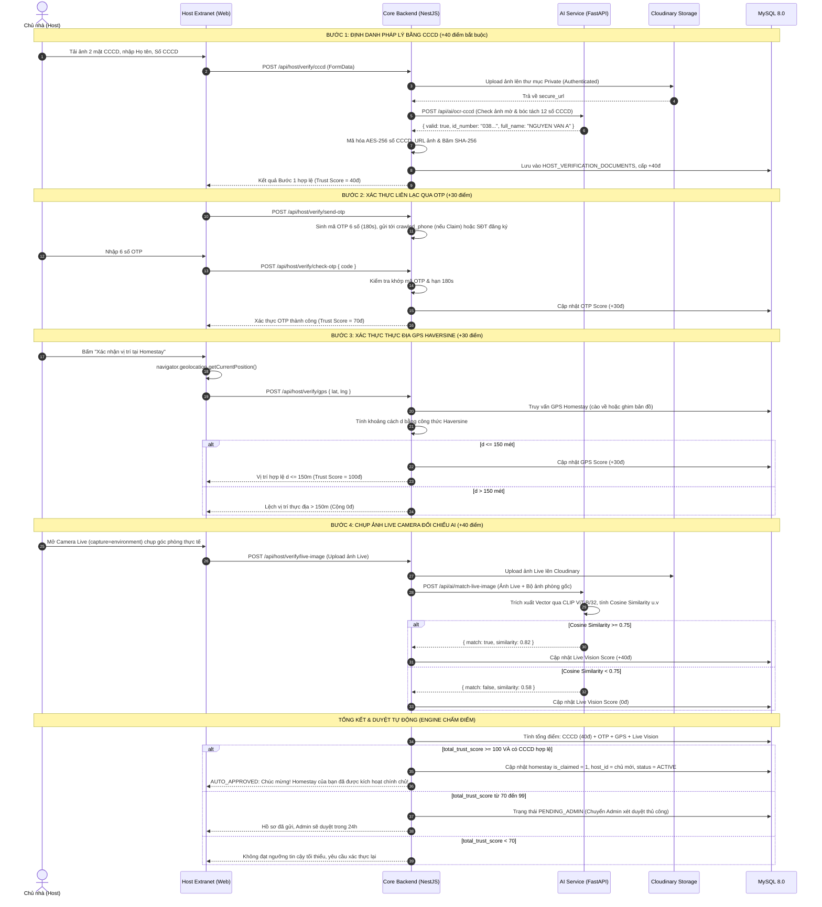
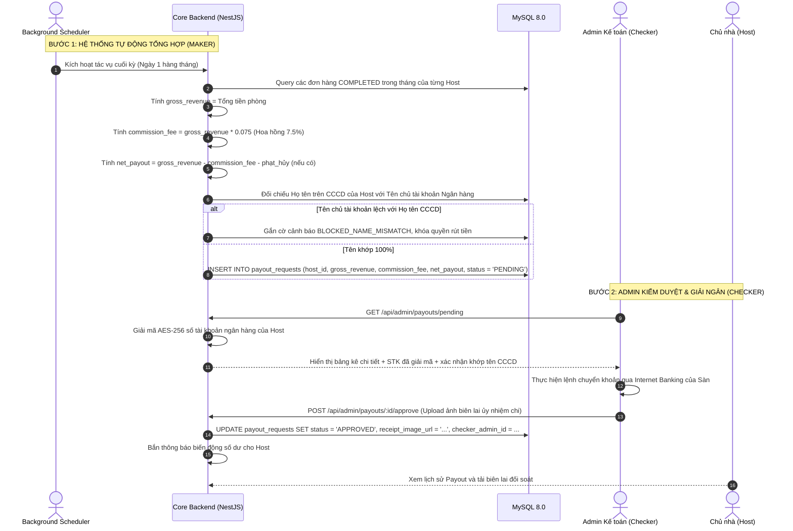
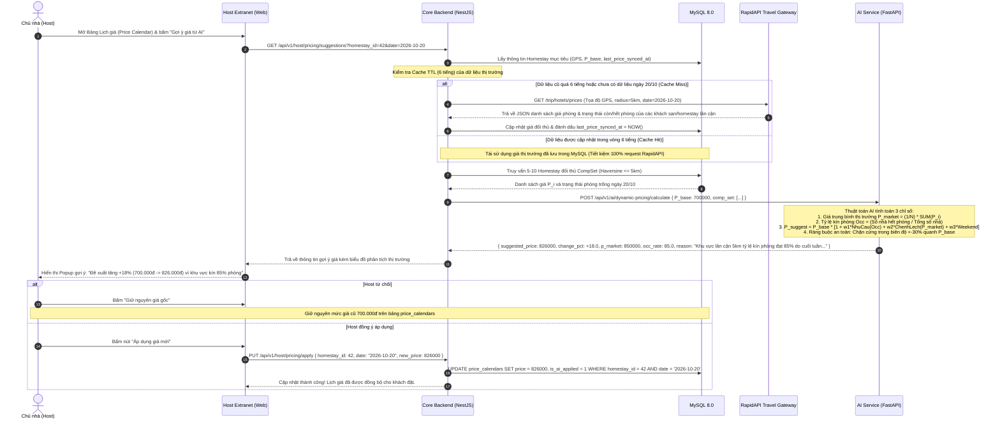
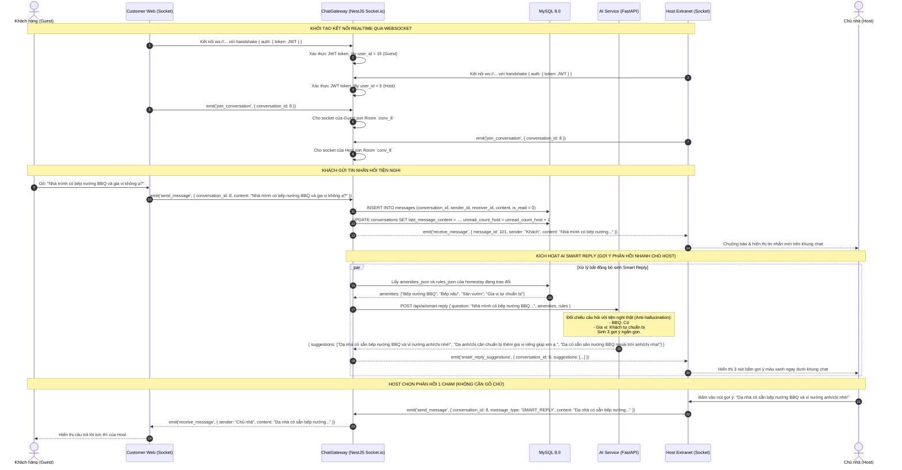
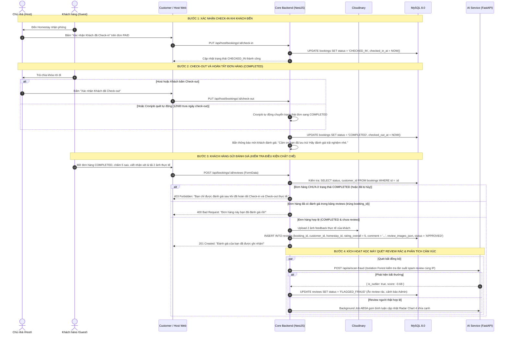

# THIẾT KẾ CÁC LUỒNG NGHIỆP VỤ & SƠ ĐỒ TUẦN TỰ (SEQUENCE DIAGRAMS)
**Tài liệu tham chiếu**: `Homestay_All_in_One_Business_Requirements_v2.1.xlsx` (Sheet `03_Quy_trinh`, `04_Quy_tac`)

---

## 1. LUỒNG 1: XÁC THỰC 4 LỚP ĐỒNG NHẤT (CCCD + OTP + GPS + AI VISION)
Áp dụng chung cho cả **Chủ nhà đăng Homestay mới** và **Chủ nhà Claim homestay cào về** (`FLOW-02`, `FLOW-03`, `BR-003`).



---

## 2. LUỒNG 2: ĐẶT PHÒNG CHÍNH CHỦ & KHÓA BI QUAN CHỐNG OVERBOOKING (`FLOW-04`, `BR-007`)

```mermaid
sequenceDiagram
    autonumber
    actor Guest1 as Khách hàng 1
    actor Guest2 as Khách hàng 2
    participant FE as Customer Web
    participant BE as Core Backend (NestJS)
    participant DB as MySQL 8.0 (InnoDB)
    participant VNP as Cổng VNPay Sandbox

    Note over Guest1, Guest2: Cả 2 khách cùng chọn 1 phòng trống duy nhất vào ngày 20/10/2026
    par Cùng bấm Đặt phòng ở cùng mili-giây
        Guest1->>FE: Bấm "Thanh toán ngay"
        FE->>BE: POST /api/bookings { room_id, date: 2026-10-20 }
    and
        Guest2->>FE: Bấm "Thanh toán ngay"
        FE->>BE: POST /api/bookings { room_id, date: 2026-10-20 }
    end

    Note over BE, DB: Khởi tạo MySQL Transaction & Khóa dòng
    BE->>DB: START TRANSACTION;
    BE->>DB: SELECT * FROM price_calendars WHERE room_id = 10 AND date = '2026-10-20' FOR UPDATE;
    
    Note over DB: Giao dịch của Khách 1 giữ khóa thành công trước.<br/>Giao dịch của Khách 2 bị Block chờ hàng đợi.

    BE->>BE: Tính tổng tiền Zero-Trust từ giá bảng price_calendars
    BE->>DB: UPDATE price_calendars SET is_available = 0, locked_until = NOW() + INTERVAL 15 MINUTE
    BE->>DB: INSERT INTO bookings (booking_code, status = 'PENDING_PAYMENT', total_amount)
    BE->>DB: COMMIT; (Khách 1 hoàn tất giữ chỗ, nhả khóa hàng đợi)

    BE->>VNP: Tạo URL thanh toán kèm chữ ký HMAC-SHA512
    BE-->>Guest1: Trả về vnpay_payment_url (Khách 1 được chuyển sang VNPay)

    Note over DB, Guest2: Giao dịch Khách 2 tiếp tục chạy sau khi Khách 1 đã Commit
    BE->>DB: Khách 2 đọc lại bản ghi vừa được cập nhật: is_available = 0
    BE->>DB: ROLLBACK;
    BE-->>Guest2: 409 Conflict: "Phòng vừa có người giữ chỗ, vui lòng chọn phòng khác!"
```

---

## 3. LUỒNG 3: THANH TOÁN VNPAY QUA IPN WEBHOOK & IDEMPOTENCY (`REQ-013`, `REQ-014`, `BR-010`, `BR-011`)

```mermaid
sequenceDiagram
    autonumber
    actor Guest as Khách hàng
    participant VNP as VNPay Gateway
    participant BE as Core Backend (NestJS)
    participant DB as MySQL 8.0

    Guest->>VNP: Quét mã QR / Nhập OTP Ngân hàng thanh toán thành công
    VNP-->>Guest: Hiển thị màn hình "Giao dịch thành công" trên App Ngân hàng

    Note over Guest, BE: Khách lỡ tay đóng trình duyệt (Return URL không gọi được)
    
    Note over VNP, BE: VNPay tự động gọi ngầm Webhook Server-to-Server (IPN)
    VNP->>BE: GET /api/vnpay/ipn?vnp_Amount=...&vnp_TxnRef=...&vnp_SecureHash=...
    
    BE->>BE: Bóc tách tham số, tính lại mã băm HMAC-SHA512 với vnp_HashSecret
    alt Sai chữ ký Checksum
        BE-->>VNP: { RspCode: "97", Message: "Invalid Checksum" }
    else Khớp chữ ký hợp lệ
        BE->>DB: SELECT status FROM bookings WHERE booking_code = vnp_TxnRef
        alt Đơn hàng đã ở trạng thái PAID trước đó (Gói tin IPN gửi trùng)
            BE-->>VNP: { RspCode: "02", Message: "Order already confirmed" } (Đảm bảo Idempotency)
        else Đơn hàng đang ở PENDING_PAYMENT
            BE->>DB: START TRANSACTION;
            BE->>DB: UPDATE bookings SET status = 'PAID', paid_at = NOW();
            BE->>DB: INSERT INTO payments (booking_id, vnp_transaction_no, amount, status = 'SUCCESS');
            BE->>DB: UPDATE price_calendars SET locked_until = NULL; (Chốt kín lịch chính thức)
            BE->>DB: COMMIT;
            BE-->>VNP: { RspCode: "00", Message: "Confirm Success" }
            BE->>BE: Bắn thông báo Socket.io / Email cho Khách và Host
        end
    end
```

---

## 4. LUỒNG 4: HỦY PHÒNG & HOÀN TIỀN KÝ QUỸ ESCROW (`BR-021`, `FLOW-11`)

```mermaid
sequenceDiagram
    autonumber
    actor Guest as Khách hàng
    participant FE as Customer Web
    participant BE as Core Backend (NestJS)
    participant DB as MySQL 8.0
    actor Host as Chủ nhà (Host)

    Guest->>FE: Bấm "Yêu cầu hủy phòng" trên đơn đã thanh toán
    FE->>BE: POST /api/bookings/:id/cancel { reason }
    
    BE->>DB: Lấy thông tin booking (check_in_date, total_amount, cancellation_policy)
    BE->>BE: Tính khoảng thời gian Delta_Hours = (check_in_date - NOW())
    
    Note over BE: Áp dụng quy tắc hoàn tiền theo Cancellation Policy của Homestay
    alt Linh hoạt (FLEXIBLE) và Delta_Hours >= 24h
        BE->>BE: Tỷ lệ hoàn 100% (refund_amount = total_amount)
    else Tiêu chuẩn (MODERATE) và Delta_Hours từ 24h đến 120h (5 ngày)
        BE->>BE: Tỷ lệ hoàn 50% (refund_amount = total_amount * 0.5)
        BE->>BE: 50% còn lại trừ hoa hồng 7.5% chuyển cho Host đền bù
    else Nghiêm ngặt (STRICT) và Delta_Hours < 168h (7 ngày)
        BE->>BE: Tỷ lệ hoàn 0% (Không hoàn lại)
    end

    BE->>DB: START TRANSACTION;
    BE->>DB: UPDATE bookings SET status = 'CANCELLED';
    BE->>DB: UPDATE price_calendars SET is_available = 1 WHERE room_id = X AND date BETWEEN ...; (Mở lại phòng)
    BE->>DB: INSERT INTO refund_transactions (booking_id, refund_amount, status = 'PROCESSED');
    BE->>DB: COMMIT;

    BE->>BE: Kích hoạt hoàn tiền từ Tài khoản Escrow của Sàn về STK của Khách
    BE-->>FE: Thông báo: "Hủy phòng thành công. Tiền hoàn đã được gửi lại tài khoản của bạn."
```

---

## 5. LUỒNG 5: ĐỐI SOÁT HOA HỒNG 7.5% & GIẢI NGÂN MAKER-CHECKER KHỚP CCCD (`REQ-016`, `BR-013`, `BR-020`)



---

## 6. LUỒNG 6: GỢI Ý GIÁ ĐỘNG BẰNG AI & ĐỒNG BỘ THỊ TRƯỜNG RAPIDAPI (`FLOW-06`, `REQ-021`, `BR-015`)

### Cơ chế 2 tầng dữ liệu & Chiến lược gọi RapidAPI:
1. **Dữ liệu Tĩnh (Chỉ lấy 1 lần duy nhất)**: Tên, địa chỉ, GPS, tiện nghi, album ảnh gốc -> Lưu vào DB, vĩnh viễn không gọi lại API ngoài.
2. **Dữ liệu Động (Cập nhật nuôi AI Dynamic Pricing)**: Giá hôm nay/cuối tuần và tỷ lệ phòng kín ($Occ$) của cụm đối thủ (CompSet 3-5km):
   - **Thời điểm 1 (On-Demand with TTL 6h)**: Khi Host mở bảng giá và bấm "Nhận gợi ý AI", nếu `last_price_synced_at` cũ quá 6 tiếng thì BE mới gọi 1 request sang RapidAPI để lấy giá & phòng trống mới nhất. Nếu còn dưới 6h, lấy thẳng từ DB (0 tốn request).
   - **Thời điểm 2 (Cronjob 02:00 AM)**: Tự động chạy quét giá 7-14 ngày tới của các cụm homestay đối thủ.



---

## 7. LUỒNG 7: CHAT REALTIME & GỢI Ý CÂU TRẢ LỜI NHANH AI (SMART REPLY) (`REQ-022`, `BR-014`)



---

## 8. LUỒNG 8: XÁC NHẬN CHECK-IN, CHECK-OUT & ĐÁNH GIÁ (RATING & REVIEW) (`REQ-019`, `BR-018`)




